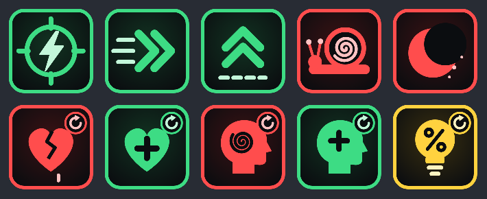

# 상태 아이콘 (버프·디버프·패시브)

작성: 2026-11-18. HUD 체력바 옆에 걸려 있는 효과를 보여 줄 아이콘 원본이다. UI 작업 때 연결한다.

## 색 규칙
| 색 | 뜻 | 아이콘 |
|---|---|---|
| 초록 | 이로운 효과 | 이동 속도 증가, 점프력 증가, 공격 속도 증가, 답변마다 체력 회복, 답변마다 정신력 회복 |
| 빨강 | 해로운 효과 | 이동 속도 감소, 답변마다 체력 감소, 답변마다 정신력 감소, 방 어두워짐 |
| 노랑 | 운에 달린 효과 | 답변마다 스택 확률 (전구 + %) |

- 오른쪽 위 **순환 화살표**는 "답변할 때마다 발동"하는 패시브 표시다.

## 파일과 효과 연결
| 파일 | 효과 태그 | Param / 조건 |
|---|---|---|
| `T_Buff_Haste` | `Effect.Buff` | `Buff_Haste` |
| `T_Buff_Jump` | `Effect.Buff` | `Buff_Jump` |
| `T_Buff_AttackSpeed` | `Effect.Buff` | `Buff_AttackSpeed` |
| `T_Buff_Slow` | `Effect.Buff` | `Buff_Slow` |
| `T_Passive_Health_Up` / `_Down` | `Effect.Passive.AnswerHealth` | Value 양수 / 음수 |
| `T_Passive_Sanity_Up` / `_Down` | `Effect.Passive.AnswerSanity` | Value 양수 / 음수 |
| `T_Passive_StackChance` | `Effect.Passive.AnswerStackChance` | - |
| `T_Env_Darken` | `Effect.Env.Darken` | - |

## 폴더
- `png/`: 언리얼 임포트용 (256×256, 투명 모서리)
- `svg/`: 원본 벡터
- `make_icons.py`: SVG 생성 스크립트. 색이나 모양을 고치려면 이 파일을 수정해 다시 생성한 뒤 PNG로 변환한다.
  - 실행: `python make_icons.py svg` (언리얼 내장 파이썬도 가능: `Engine/Binaries/ThirdParty/Python3/Win64/python.exe`)
  - PNG 변환: Edge 헤드리스 `msedge --headless=new --default-background-color=00000000 --window-size=256,256 --screenshot=<출력.png> <svg 파일 경로>`

## 언리얼 임포트 (사용자)
1. 콘텐츠 브라우저 (Content Browser)에서 `Content/01_OEC/06_UI/Icons/Status/` 폴더를 만들고 `png/`의 파일 10개를 끌어다 놓는다.
2. 임포트된 텍스처를 모두 선택 → 우클릭 → **에셋 액션 (Asset Actions) › 속성 매트릭스를 통한 대량 편집 (Bulk Edit via Property Matrix)**:
   - 텍스처 그룹 (Texture Group): **UI**
   - 압축 세팅 (Compression Settings): **사용자 인터페이스 2D (UserInterface2D)**
   - 밉 생성 세팅 (Mip Gen Settings): **밉 없음 (NoMipmaps)**
   - 한글 표기가 다르게 보이면 디테일 패널 검색창에 영문 이름을 입력해 찾는다.
